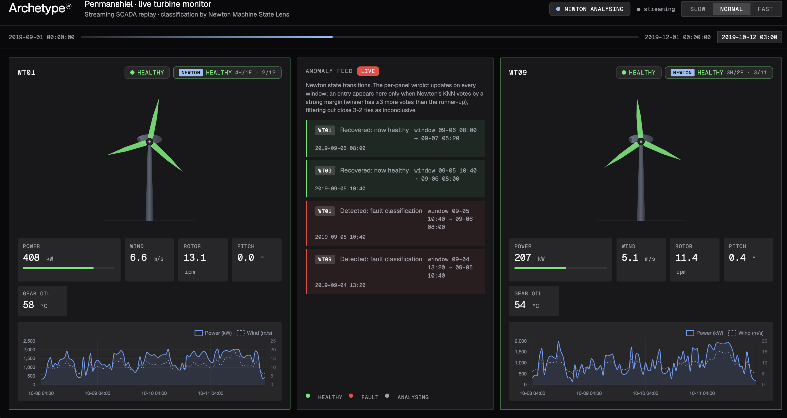

# Penmanshiel · live turbine anomaly monitor

A side-by-side live demo of [Archetype AI's Newton](https://www.archetypeai.io/) **Newton Omega 1.5** time-series encoder, on the Archetype AI Inference API, classifying real wind-turbine SCADA telemetry. Three months of data from the Penmanshiel wind farm are replayed at hourly cadence in the browser; each ~21-hour window is embedded by Omega 1.5 (one call per window, all four channels) and scored by a **local KNN** against an n-shot library of `healthy` / `fault` reference windows through one Inference API session. The verdicts drive the per-turbine state, the anomaly feed, and the SVG blade colours in real time.

> Moved from Omega 1.4 on the Direct Query API to Omega 1.5 on the Inference API: see [MIGRATION.md](MIGRATION.md) for what changed and how the two compare.

**All inference — every state badge, every anomaly feed entry, every blade colour — comes from Newton.** There is no local heuristic; the Flask backend is a thin replay-streamer plus a background Omega classifier (built on the official `archetypeai` Python client).

The dataset features a documented frequency-converter outage on **WT01** in early November 2019. Its healthy peer **WT09** runs the same hardware on the same hill in the same minute-by-minute wind. The demo invites you to watch Newton find the difference.



## What the app does

- **Replays** 2,184 hourly SCADA ticks (2019-09-01 → 2019-12-01) for WT01 + WT09 over an SSE stream, driven by a **Start / Stop** control.
- **Classifies each 128-sample (~21 h) window with Omega 1.5**: the four signal channels are embedded together in one call to an Inference API session whose window size is 128, and scored by a local KNN against the n-shot library (see [Architecture](#architecture)).
- **Runs the classifier in a background thread** and drains `newton_prediction` verdicts onto the SSE stream (~50 windows per turbine), paced to the replay timeline so a verdict surfaces as the playhead reaches its window.
- **Emits debounced anomaly events** on strong-majority verdict transitions (`fault` ↔ `healthy`) — see [Anomaly logic](#anomaly-logic) for the why.
- **Maps the embeddings** in a collapsible *Omega embeddings · 2D map* panel: a PCA-2 projection of the reference library, with each turbine's live windows drawn as a trail through the same axes as they are classified.
- **Renders the dashboard** in the Archetype AI design system (Geist sans + Geist Mono, OKLCH palette, 2 px radii, FlatLogItem-style feed). See [`templates/index.html`](templates/index.html) and [`static/style.css`](static/style.css).

## Dataset

Loaded from `./data/`. The full Penmanshiel release (~2 GB, not committed) is published on Zenodo by Charlie Plumley (Cubico), exported from Cubico's Greenbyte SCADA system, under CC BY 4.0 (see [Data attribution](#data-attribution)) — 14 turbines on the Scottish-Borders site, 2019 calendar-year SCADA at 10-minute cadence, status logs, grid-meter time-series, and PMU readings.

The demo needs (all in the WT01–10 SCADA zip):
- `data/Penmanshiel_WT_static.csv` — turbine metadata (Senvion MM82, 2,050 kW rated, 82 m rotor)
- **WT01 + WT09** full-year 10-minute SCADA — the two turbines replayed live
- **WT05 + WT06** full-year 10-minute SCADA — the n-shot reference turbines (fault outage / autumn-healthy)

The replay window (Sept 1 → Dec 1, ~13 k rows per turbine) is a slice of those CSVs. The n-shot references are **leakage-free** — they share no turbine-and-time with what we classify, so WT01's November fault is genuinely *unseen* (`_build_library()` asserts this before building):

| Class | Source | Window | Why disjoint from the live data |
|---|---|---|---|
| `healthy` | WT09 | 2019-07-01 → 2019-07-22 | summer — a different time than the live window |
| `healthy` | WT06 | 2019-10-01 → 2019-10-22 | a different turbine (autumn baseline → matches the live season) |
| `fault` | WT05 | 2019-03-08 06:00 → 03-10 00:00 | a different turbine's sustained ~36 h frequency-converter outage |

Per the [`atai-newton-omega-model`](https://github.com/archetypeai/agent-skills/tree/main/skills/atai-newton-omega-model) skill, every window is z-scored per channel with a global scaler fit on the reference pool, so library and live windows share one reference frame. Healthy windows are capped to balance the KNN vote against the fewer fault windows. **Why cross-turbine for `fault`:** WT01's only 2019 fault is the November event we replay — using it as the reference would be leakage, so the fault class is learned from WT05's *same-type* outage instead, and detecting WT01's is genuine generalization.

### Fetching the data

The dataset lives on Zenodo — either [record 16807304](https://zenodo.org/records/16807304) (newer; also mirrored on [HLRS WindLab](https://windlab.hlrs.de/dataset/zenodo-16807304/resource/b16ea689-f8ca-4873-bf19-81110daf191c)) or [record 5946808](https://zenodo.org/records/5946808) (the original release). Both contain the same WT01–15 Penmanshiel SCADA at 10-minute cadence; the filenames and directory layout below are identical between the two — substitute either record number into the URLs. License: CC-BY-4.0.

You need **two files** for this demo — the SCADA zip that contains WT01 and WT09, plus the static metadata:

```bash
mkdir -p data && cd data

# WT01-10 2019 SCADA (~1.9 GB zipped, includes WT01 + WT09)
wget https://zenodo.org/api/records/16807304/files/Penmanshiel_SCADA_2019_WT01-10_3112.zip/content \
    -O Penmanshiel_SCADA_2019_WT01-10_3112.zip
unzip Penmanshiel_SCADA_2019_WT01-10_3112.zip
rm Penmanshiel_SCADA_2019_WT01-10_3112.zip

# Static metadata (rated power, hub height, lat/long, etc.)
wget https://zenodo.org/api/records/16807304/files/Penmanshiel_WT_static.csv/content \
    -O Penmanshiel_WT_static.csv

cd ..
```

After extraction your `data/` directory should look like:

```
data/
├── Penmanshiel_WT_static.csv
└── Penmanshiel_SCADA_2019_WT01-10_3112/
    ├── Turbine_Data_Penmanshiel_01_2019-01-01_-_2020-01-01_1075.csv  # WT01 (faulty)
    ├── Turbine_Data_Penmanshiel_09_2019-01-01_-_2020-01-01_1075.csv  # WT09 (healthy peer)
    ├── Turbine_Data_Penmanshiel_02_2019-01-01_-_2020-01-01_1075.csv
    ├── Status_Penmanshiel_01_…csv
    └── … (other turbines and status logs, not used by the demo)
```

At runtime the demo reads only the **WT01** and **WT09** turbine-data CSVs plus the static metadata. The **WT05** and **WT06** CSVs are read once by `build_library.py` to embed the n-shot reference windows (all four turbines are in the same WT01–10 zip). The remaining files in the zip (WT02, WT04, WT07, WT08, WT10, status logs) are harmless extras — `data_loader.discover_turbines()` enumerates whatever is present.

**Optional extras**, not needed for the demo:
- `Penmanshiel_SCADA_2019_WT11-15_3117.zip` — WT11–15 2019 SCADA.
- `Penmanshiel_WT_dataSignalMapping.xlsx` — column-name reference for the SCADA exports.

## Setup

Requires Python 3.11+ (the Archetype AI Python client needs ≥ 3.10), an Archetype AI API key, and the Penmanshiel dataset.

```bash
# Clone
git clone https://github.com/archetypeai/archetypeai-wind-turbine-demo-model-serving.git
cd archetypeai-wind-turbine-demo-model-serving

# Fetch the dataset (see above) into ./data/

# Credentials
cp .env.example .env
# Edit .env with your ATAI_API_KEY and ATAI_API_ENDPOINT

# Virtual env — use whichever python3 you have (verified on 3.12 and 3.14).
# No `activate` step: every command below calls .venv/bin/ explicitly.
python3 -m venv .venv
.venv/bin/pip install -r requirements.txt

# Precompute the n-shot reference library once (writes library.json)
.venv/bin/python build_library.py

# Run
.venv/bin/python app.py
open http://127.0.0.1:5050/
```

`build_library.py` embeds the static reference windows offline and saves them to
`library.json`, so the app loads them instantly at runtime instead of re-embedding
on every cold start. If `library.json` is missing (or you change a reference window /
window size / model), the app rebuilds it live on the first **Start** — and you can
re-run `build_library.py` to refresh the file. With the library precomputed, runtime
only needs the **WT01 + WT09** data; the reference turbines (WT05, WT06) are only read
when building the library.

Press **Start** to begin the replay (and **Stop** to end it). The library load is
near-instant, so classification begins right away.

## Using the UI

- **Top bar**: Archetype AI wordmark · title · live `Building reference library…` / `Newton analysing` / `Newton complete` status pill · connection-state dot (`idle` → `streaming` → `ready`) · **Start / Stop** button.
- **Timeline strip**: simulated date range with a cursor that advances per tick; `t-now` mono readout on the right.
- **Per-turbine panel** (left and right of the feed):
  - `ANALYSING` / `HEALTHY` / `FAULT` state badge (driven by Newton's *debounced* state).
  - `NEWTON {class} {H/F · X/Y}` verdict badge — updates the vote counter on every prediction, but the colour/pulse only flips on strong-majority verdicts (filters out close 3-2 KNN ties).
  - Animated SVG turbine — rotor spin tracks measured RPM; blade colour mirrors the panel state.
  - Numeric stat row (Power / Wind / Rotor RPM / Pitch / Gear oil) in mono with current-window values.
  - Rolling 96-tick power + wind sparkline.
- **Anomaly feed** (centre column): strong-majority state transitions ("Detected: fault classification", "Recovered: now healthy") with the window range and timestamp. Single 3-2 KNN flickers are intentionally suppressed.
- **Omega embeddings · 2D map** (below the panels, click to expand): healthy and fault library windows as green and red dots, each turbine's live windows as a trail coloured by verdict, the latest ringed. The note under the plots gives the variance the two axes explain and the library's leave-one-out KNN accuracy, measured in the full embedding space rather than in 2D.

## Architecture

On first use the app opens one Inference API session on `omega-embedding` (Omega 1.5) with its window size set to the demo's 128 rows, then embeds each window with one call to that session carrying all four channels. Classification is a plain k-nearest-neighbour vote against an in-memory reference library — entirely on our side.

```
                ┌──────────────────────────────────────────────────┐
                │          Archetype AI Inference API              │
                │  POST /api/inference/sessions          (once)    │
                │    model:  omega-embedding  (Omega 1.5)          │
                │    values: window_size 128, step_size 128        │
                │  POST /api/inference/sessions/{id}/query         │
                └───────────────▲────────────┬─────────────────────┘
                  one call per  │            │ 4 × 768-d embedding
                  window, 4 ch  │            │ (one 3072-d row)
                  × 128 rows    │            ▼
   ┌────────────────────────────┴───────────────────────────────┐
   │  Flask backend (newton_client.BackgroundClassifier)         │
   │                                                             │
   │  offline 1×:  reference windows ──► z-score (global scaler) │
   │  (saved to    ──► embed ──► library                         │
   │  library.json)                                              │
   │                                                             │
   │  per window:  WT01/WT09 slice ──► z-score ──► embed ──►      │
   │               KNN(k=5) vs library ──► {class,vote}          │
   └─────────────────────────────────────────────────────────────┘
```

### Window size and sessions

Without a session, `omega-embedding` cuts its input into 1024-sample windows, so a call needs at least 1024 samples per channel: shorter input forms no window and comes back as `{"success": false}` with no message. The demo's windows are 128 rows (~21 h at 10-minute cadence), and 1024 real rows (~7 days) wouldn't work, because the WT05 fault reference is only ~36 h long.

A session overrides those values (`SESSIONS_PATH`, `_session_values()`), so one 128-row slice is exactly one window. Omega 1.5 left-pads windows shorter than its native 1024 and masks the padding out of attention and pooling, so a 128-sample embedding is encoded properly. `_get_session()` opens the session lazily, reopens it if a query answers `session_not_running` (a session ends when it expires or the model is redeployed), and an `atexit` hook cancels it, since an organization may hold at most 16 open sessions on the model.

### How it works

1. **Build the library once, offline** (`build_library.py` → `save_library`). The curated reference windows (table above) are sliced, z-scored with a single global scaler fit on the reference pool, embedded (all four channels in one call, returned as one 3072-value vector per window) — then persisted to `library.json` with the scaler and a config fingerprint. Healthy windows are capped (`HEALTHY_CAP`) so the KNN vote isn't swamped by the larger healthy class. `_assert_disjoint()` runs first and raises if any reference window overlaps the live turbines/time — leakage fails loudly rather than silently inflating accuracy. At runtime `_build_library()` loads `library.json` instantly (no embed calls); if it's missing or the fingerprint changed, it rebuilds live. This is the [`atai-newton-omega-model-data-prep`](https://github.com/archetypeai/agent-skills/tree/main/skills/atai-newton-omega-model-data-prep) offline/runtime split.
2. **Classify in the background** (`BackgroundClassifier`). A worker thread walks both live turbines' replay windows, embeds each the same way, runs `_knn(vec, library, k=KNN_K)`, and pushes `newton_prediction` events (with `class`, `votes`, and a `tick_index` mapping the window onto the replay timeline) onto a queue. `app.py` drains that queue and *releases* each prediction when the visible timeline reaches its `tick_index`, so predictions stay aligned with the scrubbing playhead.
3. **One session call per window, with retries** (`_embed_window`). All four channels go in a single request; a `success: false` response or a wrong-sized vector counts as a failure and is retried up to `OMEGA_RETRIES` times, opening a new session first if the old one has ended.

All of this lives in [`newton_client.py`](newton_client.py); the official [`archetypeai`](https://pypi.org/project/archetypeai/) Python client makes the session calls via `client.requests_post`.

## Anomaly logic

KNN on a small n-shot library returns the occasional split (4-1, 3-2) vote on borderline windows. The demo treats a verdict as **strong** only when the winning class leads the runner-up by ≥ `STRONG_MARGIN` votes (with `k=5`: 5-0 or 4-1 qualify; 3-2 doesn't). `app.py:_anomaly_from` commits a state change — and fires an anomaly entry — only on the first strong verdict in a new direction; weak verdicts update the vote counter but don't flip the panel. The per-panel verdict badge surfaces the raw votes so users can see *why* each decision fired.

Validated on held-out windows (none in the library): WT01's November fault is detected as it develops — the onset window still reads healthy, then flips to fault — with **zero false positives** on the healthy turbine and its peers.

## API surface

| Endpoint | What it returns |
|---|---|
| `GET /` | The dashboard UI |
| `GET /api/scada/<wt_id>` | Downsampled 3-month SCADA series for a single turbine (JSON, debug aid) |
| `GET /api/projections` | PCA-2 coordinates of the library windows, variance explained, and leave-one-out KNN accuracy (live window coordinates ride on each `newton_prediction` as `coords`) |
| `GET /api/replay?tps=N` | SSE stream: `meta`, `newton_status`, `tick`, `newton_prediction`, `anomaly`, `complete` |

`tps` (ticks/sec) clamps to `[1, 200]`; the replay duration scales linearly with it. The UI requests a fixed `tps=15` (the Start button) for a steady ~2.5-minute replay, but the endpoint accepts any value. The background classifier runs ahead of the playhead; `app.py` buffers its predictions and releases each one as the visible timeline reaches its `tick_index`, so predictions stay aligned with playback at any speed.

## Project layout

```
app.py                         # Flask + SSE; tick loop; prediction release + anomaly synth
projections.py                 # PCA-2 of the library for the embedding map + leave-one-out KNN accuracy
build_library.py               # Offline: embed reference windows → library.json (run once)
library.json                   # Precomputed n-shot library (scaler + vectors + fingerprint)
newton_client.py               # Omega (Inference API) + local KNN:
                               #   _get_client, ensure_scaler, _scale_frame,
                               #   _get_session / _embed_window (Omega session),
                               #   _knn, save_library / _load_library,
                               #   _build_library (disk → live fallback),
                               #   BackgroundClassifier (worker thread),
                               #   replay_events (pure SCADA tick streamer)
data_loader.py                 # CSV reader, window slicing, hourly downsampling
templates/index.html           # Topbar + timeline + 3-column grid
templates/_turbine_card.html   # Reusable panel: state badge, SVG, stats, spark
templates/_wordmark.svg        # Archetype AI wordmark (inlined for currentColor)
static/style.css               # OKLCH tokens, Geist fonts, sharp radii, FlatLogItem feed
static/app.js                  # SSE consumer, panel updates, rotor RAF loop, Chart.js spark
requirements.txt
.env.example
LICENSE                        # Apache-2.0
```

## Lessons learned

- **Leakage discipline drives accuracy, not model tuning.** The first build classified almost everything backwards because the fault reference (WT05, Mar 7–17) was mostly *non-fault* hours and the only healthy reference was summer-only — so the KNN keyed on season and turbine identity, not on fault. Tightening the fault reference to WT05's sustained ~36 h outage, adding an autumn healthy baseline (WT06 Oct) to match the live season, and capping the healthy class fixed it. `_assert_disjoint()` enforces the rule in code.
- **Omega 1.5 embeddings differ from Omega 1.4.** The library must be rebuilt (`python build_library.py`) whenever the model changes; the fingerprint in `library.json` includes the model and endpoint, so a stale library is rebuilt automatically.
- **The project `.env` overrides shell variables** (`load_dotenv(override=True)`), so an `ATAI_API_*` exported in your shell profile can't silently point the app at another deployment.
- **A fitted global scaler still applies.** Omega 1.5 z-scores every window internally and adds a scale token built from the raw mean and std, so amplitude survives inside the model; `normalize_input` has no effect on the Inference API. The demo keeps its global scaler so library and live windows share one reference frame.
- **Session values are part of the library fingerprint.** Changing the window size changes every embedding, so `library.json` records the session values and is rebuilt when they change.

## Credits

- **SCADA data**: Penmanshiel Wind Farm Data, Plumley (Cubico) 2022, CC BY 4.0 — see [Data attribution](#data-attribution).
- **Inference**: Newton Omega 1.5 (`omega-embedding`) on the Archetype AI Inference API, with local KNN classification.
- **Visual design**: [Archetype AI design system](https://github.com/archetypeai/agent-skills/tree/main/skills/atai-design-system) — Geist + Geist Mono, OKLCH palette, sharp 2 px radii.

## Licence

The code is under the [Apache License 2.0](LICENSE). The data is the Plumley (Cubico)
Penmanshiel release, under CC BY 4.0: see [Data attribution](#data-attribution).

## Data attribution

All turbine data used here comes from **Penmanshiel Wind Farm Data**:

- **Authors:** Charlie Plumley (Cubico); Charlie Plumley and Roberta Takeuchi for the 2025 version.
- **Dataset:** Zenodo, 2022 (version 0.0.2),
  [doi:10.5281/zenodo.5946808](https://doi.org/10.5281/zenodo.5946808); updated 2025,
  [doi:10.5281/zenodo.16807304](https://doi.org/10.5281/zenodo.16807304). All versions:
  [doi:10.5281/zenodo.5946807](https://doi.org/10.5281/zenodo.5946807). Both versions hold the
  2019 files used here.
- **Source system:** 10-minute SCADA and events data from the site's 14 Senvion MM82 turbines,
  extracted from Cubico's secondary SCADA system (Greenbyte).
- **Terms:** [Creative Commons Attribution 4.0 International (CC BY 4.0)](https://creativecommons.org/licenses/by/4.0/);
  copying, modifying and redistributing are allowed with attribution. The data is provided
  as is, without warranties.
- **No endorsement:** neither the authors nor Cubico are involved in this demo or endorse it.

**What was changed** (nothing in this repo redistributes the data; `data/` is fetched separately,
and `library.json` holds only derived embeddings and scaler statistics): only the 2019 SCADA for
WT01, WT05, WT06 and WT09 and the static turbine metadata are read; four signals (wind speed,
power, pitch angle, gear oil temperature) were z-scored with the reference windows' statistics,
cut into 128-row windows and embedded with Omega 1.5; the replay is downsampled to hourly for
display. The app's footer carries the same credit.
